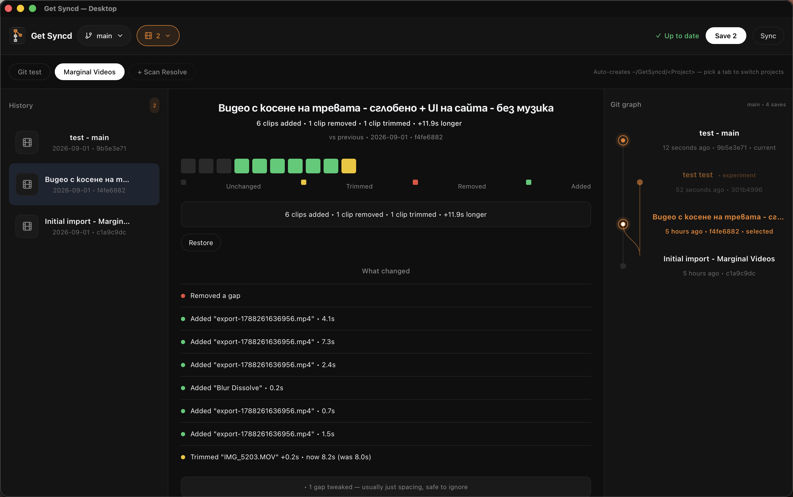
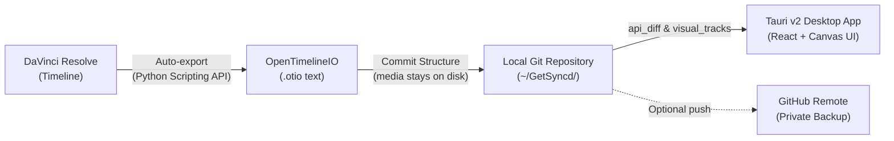

# Get Syncd 🎬

<p align="center">
  <strong>Git-Powered Version Control & Visual Timeline Diff for DaVinci Resolve</strong>
</p>

<p align="center">
  <a href="https://github.com/MihailM17/get-syncd/releases"></a>
  <a href="https://opensource.org/licenses/MIT"></a>
  <a href="https://www.python.org/downloads/"></a>
  <a href="https://tauri.app/"></a>
  <a href="https://developer.apple.com/macos/"></a>
  <a href="https://www.blackmagicdesign.com/products/davinciresolve"></a>
</p>

---

Say goodbye to `Project_Cut_v3_FINAL_really_FINAL.drp`.

**Get Syncd** brings Git version control to video editing workflows. Every time you hit **Save Snapshot**, Get Syncd snapshots your open DaVinci Resolve timeline structure into OpenTimelineIO (OTIO), commits it locally, and generates an instant, plain-English visual diff of everything that changed:

> *"3 trimmed, 1 added, runtime -1.4s"*

Your **heavy media files stay on your local drive** — only the lightweight timeline XML/JSON structure is versioned. It is fast, works with the free version of DaVinci Resolve (no Studio license required), and can be backed up to private GitHub repositories for free.

---

## ✨ What's New in v0.4.0 (Redesign)



* **Hero Multi-Track Visual Timeline:** Inspect proportional before/after clips across video and audio tracks with interactive playhead scrubbing, zoom (`1×`–`4×`), and SMPTE timecode readout.
* **Diff Overlay & Split Views:** Instantly toggle between **Diff Overlay** (`1`) with ghost blocks for deleted clips and **Split Before/After** (`2`).
* **Live DaVinci Resolve Indicator:** Real-time connection badge (`● Resolve · Project`) displaying active project and timeline state.
* **Interactive Cut Tree:** Visual multi-lane Git tree showing alternative cuts and branches with cubic Bézier fork curves.
* **2-Step Safe Restore:** One-click rollback directly into DaVinci Resolve via the scripting API, with automatic safety backups and an offline fallback instructions drawer with a **Copy Path** button.
* **Bidirectional Scrubber Sync:** Click any clip in the timeline canvas to scroll directly to its change row in *What Changed*, and vice-versa.
* **Offline & Local-First:** Bundled Inter and JetBrains Mono typography with zero external font CDNs and full international Cyrillic support (e.g. `Виктор Музикално Видео`).

---

## ⚡ Comparison

| Feature | Traditional Workflow (`.drp` copies) | Get Syncd |
| :--- | :--- | :--- |
| **History Tracking** | Duplicated `.drp` files cluttering folders | Instant micro-commits with human descriptions |
| **Comparing Cuts** | Opening multiple projects and eyeballing | Visual multi-track canvas + plain-English diffs |
| **Restore** | Hunt through file names and re-link media | 1-Click Restore directly into open Resolve timeline |
| **Storage Overhead**| Full project databases (Gigabytes) | OTIO text structure (Kilobytes), fits free GitHub |
| **Alternative Cuts** | Duplicate folder hierarchies | Instant Git branches (`get-syncd branch experiment`) |
| **Collaboration** | Sending project files over WeTransfer | Git commits & pushes to private GitHub repos |

---

## 🚀 Download & Installation

Grab the ready-to-run installer for macOS from [**GitHub Releases**](https://github.com/MihailM17/get-syncd/releases):

* 🍏 **macOS:** Download the `.dmg` installer (Apple Silicon / Intel). Open the `.dmg` and drag `Get Syncd.app` into `Applications`.
* 🐧 **Linux & 🪟 Windows:** Pre-built bundles (`.AppImage` / `.msi`) are available under Releases, or build locally using the instructions below.

### First Launch Wizard
On first launch, Get Syncd automatically:
1. Detects your running DaVinci Resolve application.
2. Initializes your projects directory at `~/GetSyncd`.
3. (Optional) Connects your private GitHub account via `gh` CLI for free offsite timeline backups.

---

## ⌨️ Keyboard Shortcuts

Speed up your cutting workflow with built-in hotkeys:

| Shortcut | Action |
| :--- | :--- |
| <kbd>⌘S</kbd> / <kbd>Ctrl+S</kbd> | Open **Save Snapshot** modal |
| <kbd>1</kbd> | Switch timeline canvas to **Diff Overlay** mode |
| <kbd>2</kbd> | Switch timeline canvas to **Split Before / After** mode |
| <kbd>J</kbd> | Navigate to **Next Change** (syncs playhead & highlights clip) |
| <kbd>K</kbd> | Navigate to **Previous Change** (syncs playhead & highlights clip) |
| <kbd>↑</kbd> / <kbd>↓</kbd> | Step through snapshot history |
| <kbd>Esc</kbd> | Dismiss any open modal or popover |

---

## 🛠️ Architecture & How It Works



1. **Auto-Export:** Clicking **Save Snapshot** uses Resolve's scripting API to export the open timeline to `timelines/<name>.otio`.
2. **Git Versioning:** The OTIO file is committed to the project's local Git repository with your note.
3. **Semantic Diff:** `diff.py` computes clip insertions, deletions, trims, timecode shifts, and retimed assets.
4. **Visual Display:** `TimelineDiffCanvas` renders the multi-track visual timeline alongside track change cards.
5. **Safe Restore:** When restoring an older cut, Get Syncd creates a safety snapshot of current edits, writes back the historical `.otio`, and auto-imports the cut into Resolve.

---

## 💻 CLI Quickstart

If you prefer working in the terminal:

```bash
# Clone and setup development environment
git clone https://github.com/MihailM17/get-syncd.git
cd get-syncd
./install-mac.sh   # or ./install-linux.sh or .\install-windows.ps1

source .venv/bin/activate

# In your film project folder:
get-syncd init
get-syncd save -m "Rough cut v1 - intro assembled"
get-syncd log                     # View snapshot history
get-syncd diff HEAD~1 HEAD        # Show plain-English diff
get-syncd restore HEAD~1 --out /tmp/cut.otio
```

---

## 🧪 Building from Source

```bash
# Run backend test suite
.venv/bin/pytest -q

# Build the Python sidecar binary
./scripts/build-sidecar.sh

# Run the Tauri desktop app in dev mode
cd app
npm install
npm run tauri:dev

# Build native production release
npm run tauri:build
```

---

## 📄 License

MIT © [Mihail Mihaylov](https://github.com/MihailM17). Feel free to use, modify, and distribute. DaVinci Resolve is a trademark of Blackmagic Design Pty Ltd.
